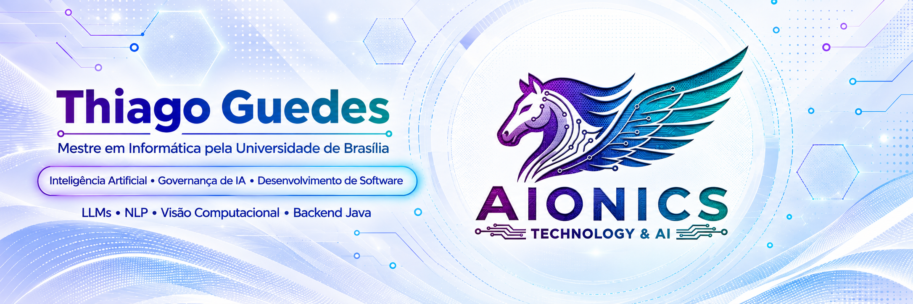

### Inteligência Artificial • LLMs • Governança de IA e Dados • Business Intelligence • Desenvolvimento de Software

**Mestre em Informática pela Universidade de Brasília (UnB)**

**[Projetos](#-portfólio-de-projetos) · [Pesquisa](#-pesquisa-em-destaque) · [Competências](#-competências-técnicas-e-referenciais) · [Formação](#-formação-complementar) · [Contato](#-contato)**

---

## 👋 Sobre mim

Sou **Thiago Guedes**, mestre em Informática pela **Universidade de Brasília (UnB)**. Minha pesquisa investiga a tradução de linguagem natural para linguagens formais com **modelos de linguagem compactos**, aprendizado em contexto, representações intermediárias, validação e avaliação experimental.

Meu portfólio conecta **pesquisa aplicada em Inteligência Artificial**, **Business Intelligence e análise de dados**, desenvolvimento de software e estudos em **Governança de IA e Dados**. Organizo projetos independentes com código, documentação e explicações das decisões técnicas, distinguindo resultados efetivamente executados de experimentos ainda em preparação.

> **Como ler este perfil:** *projetos* mostram trabalhos publicados; *competências* incluem tecnologias utilizadas e conteúdos estudados; *formação complementar* documenta cursos concluídos. Conhecer uma norma ou concluir um curso não implica certificação profissional naquela tecnologia ou organismo.

## 📌 Portfólio de projetos

Oito repositórios organizados por especialidade, com acesso direto ao código e à documentação.

### 🔬 Pesquisa em IA e LLMs

| Projeto | Escopo |
| :--- | :--- |
| **[Tradução NL para Nile com LLM compacto](https://github.com/CypherGuedes/traducao-nl-nile-llm-compacto)** | Tradução de linguagem natural para uma DSL, representação intermediária, aprendizado em contexto, validação e autocorreção. |

### 🧠 Inteligência Artificial, Machine Learning e Deep Learning

| Projeto | Escopo |
| :--- | :--- |
| **[Processamento de Linguagem Natural](https://github.com/CypherGuedes/processamento-linguagem-natural)** | Tokenização BPE, bigramas, classificação textual, DistilBERT e GPT-2. |
| **[Comparação entre RNN e CNN no Fashion-MNIST](https://github.com/CypherGuedes/comparacao-rnn-cnn-fashion-mnist)** | Código para treinamento e comparação de redes recorrentes e convolucionais; resultados dependem de executar os experimentos. |
| **[Perceptron do Zero](https://github.com/CypherGuedes/perceptron-do-zero)** | Classificação binária em Python e NumPy, treinamento supervisionado e testes. |

### 📊 Business Intelligence e Análise de Dados

| Projeto | Escopo | Tecnologias e recursos |
| :--- | :--- | :--- |
| **[Análise da Manutenção Rodoviária em Power BI](https://github.com/CypherGuedes/analise-manutencao-rodoviaria-powerbi)** | Dashboard de condição rodoviária com ICM, evolução contratual, distribuição por classificação e mapa de trechos críticos. Utiliza dados fictícios. | Power BI, Excel, CSV, Python, JSON e análise geográfica. |

### 🛡️ Governança de IA e Dados

| Projeto | Escopo |
| :--- | :--- |
| **[Governança de Dados e IA: Bytebank](https://github.com/CypherGuedes/governanca-dados-ia-bytebank)** | Estudo de caso sobre maturidade, qualidade de dados, riscos, IA responsável e monitoramento. |

### 💻 Desenvolvimento com Dart

| Projeto | Escopo |
| :--- | :--- |
| **[Saudação Interativa em Dart](https://github.com/CypherGuedes/saudacao-interativa-dart)** | Entrada e saída de dados, manipulação de strings e interação no terminal. |
| **[Calculadora de Terminal em Dart](https://github.com/CypherGuedes/calculadora-terminal-dart)** | Exercício de construção de uma calculadora para terminal com Dart. |

## 🔬 Pesquisa em destaque

### [Tradução de Linguagem Natural para Nile com Modelo de Linguagem Compacto](https://github.com/CypherGuedes/traducao-nl-nile-llm-compacto)

Pesquisa de mestrado sobre a tradução de instruções em linguagem natural para **Nile**, uma linguagem específica de domínio (DSL), investigando estratégias com **aprendizado em contexto (ICL)**, artefatos formais, **representação intermediária (IR)**, validação e autocorreção.

**Fluxos investigados:** `NL → IR → Nile` e `NL → Nile`.

**Foco metodológico:** modelos de linguagem compactos, estratégias de tradução, qualidade sintática e semântica e avaliação experimental.

[**Consultar experimentos e documentação da pesquisa →**](https://github.com/CypherGuedes/traducao-nl-nile-llm-compacto)

---

## 🧰 Competências técnicas e referenciais

As categorias abaixo diferenciam **linguagens**, **bibliotecas**, **plataformas**, **temas estudados**, **métodos de gestão** e **referenciais normativos**.

### 🧑‍💻 Linguagens e fundamentos de desenvolvimento

**Áreas:** lógica de programação, pensamento computacional, estruturas condicionais, repetição, desenvolvimento de software e programação orientada a objetos.

*JavaScript consta como formação introdutória em lógica de programação; Java e Dart fazem parte das linguagens de interesse e desenvolvimento do portfólio.*

### 🤖 Inteligência Artificial e Modelos de Linguagem

**Áreas:** Processamento de Linguagem Natural (PLN), aprendizado em contexto, engenharia de prompts, classificação de textos, geração de texto, avaliação de modelos e introdução a agentes de IA para negócios.

### 🧪 Bibliotecas, frameworks e explicabilidade

**Áreas:** aprendizado supervisionado, redes neurais, modelos Transformers, interpretabilidade e explicabilidade de IA (XAI), vieses e transparência. *SHAP e LIME são tópicos estudados em curso de explicabilidade, não reivindicação de implementação em produção.*

### 📊 Business Intelligence, análise e visualização de dados

**Aplicações demonstradas:** dashboard no Power BI, acompanhamento de indicadores (ICM), comparação entre contratos, segmentação por classes, mapas de criticidade, tratamento e auditoria de dados com Python. **DAX e Power Query** são recursos do ecossistema Power BI, mas o material fornecido não foi suficiente para verificar medidas ou transformações específicas dessas tecnologias.

### 🧠 Bibliotecas de PLN e experimentação

**Contexto:** dependências declaradas no projeto de Processamento de Linguagem Natural, que reúne tokenização BPE, bigramas, classificação textual, DistilBERT e GPT-2. Dependência declarada não significa necessariamente uso em todos os experimentos.

### ☁️ Plataformas, engenharia de dados e colaboração

**Áreas:** experimentação com notebooks, versionamento, desenvolvimento mobile, DataFrames, tratamento, enriquecimento e transformação de dados. **Apache Spark, PySpark e Databricks** foram estudados no curso *Databricks: Transformação de Dados com PySpark* (Alura, 8h), em nível introdutório.

*Jupyter Notebook identifica o formato `.ipynb`; Kaggle e Google Colab são plataformas nas quais notebooks podem ser utilizados.*

### 🛡️ Governança de IA, ética e gestão de riscos

**Tópicos:** ciclo de vida de sistemas de IA, identificação e mitigação de riscos, governança organizacional, supervisão humana, monitoramento de modelos, vieses algorítmicos, ética, transparência e controles.

**Referenciais estudados:** NIST AI RMF e ISO/IEC 42001. A menção indica conhecimento temático, não certificação oficial ou auditoria.

### 🗂️ Governança de Dados, ontologias e privacidade

**Tópicos:** qualidade de dados, metadados, catálogos, linhagem, produtos de dados, modelos de maturidade, roadmap de governança, ontologias, entidades e relacionamentos, interoperabilidade semântica, governança em nuvem e privacidade.

| Referência | Natureza |
| :--- | :--- |
| **DAMA-DMBOK** | Corpo de conhecimento e boas práticas de gestão de dados. |
| **LGPD** | Lei brasileira de proteção de dados pessoais (Lei nº 13.709/2018). |
| **Gartner** | Empresa de pesquisa e análise de mercado de tecnologia, usada como fonte de referência e tendências. |
| **NIST AI RMF** | Estrutura de gerenciamento de riscos de IA. |
| **ISO/IEC 42001** | Norma sobre sistema de gestão de inteligência artificial. |

### 📋 Métodos ágeis, liderança e comunicação

**Tópicos:** práticas de Scrum, backlog, histórias de usuário, eventos de planejamento e revisão, gestão de mudanças, liderança de equipes com IA, comunicação técnica e executiva e relacionamento com stakeholders.

*Os cursos preparatórios sobre PMI-ACP não equivalem à credencial profissional PMI-ACP.*

---

## 🎓 Formação complementar

Os certificados apresentados documentam conteúdos estudados, com destaque para duas formações estruturadas na Alura:

| Formação concluída | Conteúdos | Carga horária estimada |
| :--- | :--- | ---: |
| **[Carreira em Governança de Dados e IA, Nível 3 de 3](https://cursos.alura.com.br/career/path/certificate/2b877979-d2ee-4ab4-8343-0ce42d3438eb)** | Cloud, IA, ontologias, maturidade, produtos de dados e governança | **81h** |
| **[Trilha de Governança de Inteligência Artificial](https://cursos.alura.com.br/degree/certificate/ea8a02dd-5e3d-43f3-83f1-aeaf0a5f7ea3)** | Ética, riscos, ciclo de vida e controles de IA | **27h** |

**Outros cursos e estudos comprovados:** Databricks e PySpark; explicabilidade com SHAP e LIME; Scrum; fundamentos para PMI-ACP; JavaScript introdutório; pensamento computacional; liderança técnica com IA; agentes de IA para negócios; governança em cloud e comunicação com stakeholders.

➡️ **[Ver o catálogo organizado dos cursos e certificados](./docs/FORMACAO-COMPLEMENTAR.md)**

> As trilhas podem incluir cursos também apresentados individualmente. Por isso, suas cargas horárias não devem ser somadas indiscriminadamente como horas distintas de formação.

## 📈 Evolução contínua

Este perfil acompanha a progressão dos estudos e dos projetos. Novas tecnologias são adicionadas à seção correta conforme seu uso ou estudo; cursos entram no catálogo de formação; projetos publicados ganham repositórios independentes e links nesta página.

<strong>Como atualizar este perfil quando aprender algo novo</strong>

1. **Nova linguagem:** adicionar um selo na seção de linguagens e, se houver, um projeto que demonstre seu uso.
2. **Nova biblioteca, framework ou plataforma:** acrescentar na categoria correspondente e registrar o contexto de utilização.
3. **Novo referencial ou curso de governança:** indicar se é estudo, experiência aplicada ou certificação obtida, sem confundir essas categorias.
4. **Novo curso concluído:** adicionar uma linha no arquivo `docs/FORMACAO-COMPLEMENTAR.md`, incluindo título, instituição e certificado.
5. **Novo repositório:** inserir o link na tabela temática de projetos e atualizar a contagem de repositórios.

## 📬 Contato

Para conversar sobre **pesquisa aplicada em IA, Machine Learning, Business Intelligence, governança e desenvolvimento de software**, acesse meu [LinkedIn](https://www.linkedin.com/in/thiagoguedes1608/) ou explore os [repositórios do GitHub](https://github.com/CypherGuedes?tab=repositories).

Pesquisa aplicada · Desenvolvimento de software · Governança responsável · Aprendizado contínuo

