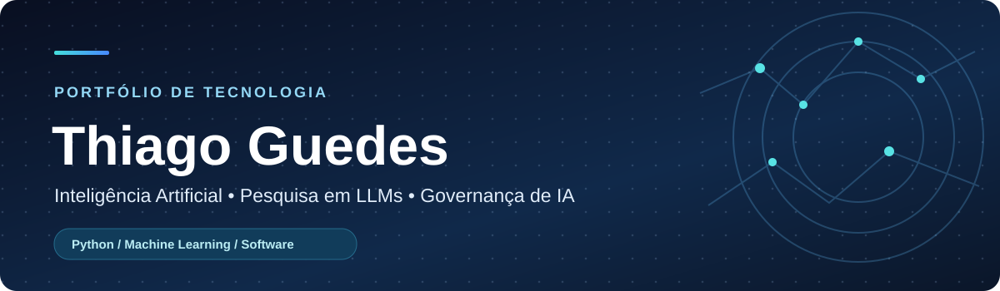

<div align="center">



### Inteligência Artificial · Pesquisa em LLMs · Governança de IA · Engenharia de Software

**Mestre em Informática pela Universidade de Brasília (UnB)**

[](https://www.linkedin.com/in/thiagoguedes1608/)
[](https://github.com/CypherGuedes?tab=repositories)
[](https://github.com/CypherGuedes/traducao-nl-nile-llm-compacto)

**[Sobre mim](#-sobre-mim) · [Projetos](#-projetos-publicados) · [Competências](#-competências-técnicas-e-referenciais) · [Evolução](#-aprendizado-contínuo) · [Contato](#-contato)**

</div>

---

## 👋 Sobre mim

Sou **Thiago Guedes**, mestre em Informática pela **Universidade de Brasília (UnB)**. Minha pesquisa envolve tradução de linguagem natural para linguagens formais com modelos de linguagem compactos, aprendizado em contexto, representações intermediárias e avaliação experimental.

Meu portfólio reúne **Inteligência Artificial (IA), Machine Learning, Processamento de Linguagem Natural (PLN), Governança de IA e Dados e desenvolvimento de software**. Registro implementações, decisões técnicas, experimentos, limitações e documentação, valorizando a reprodutibilidade.

> **Como ler este perfil:** as seções de projetos mostram entregas publicadas. A matriz de competências apresenta linguagens, ferramentas, plataformas e referenciais que estudo ou utilizo, sem implicar certificações profissionais nem domínio avançado de todos os itens.

## 📌 Repositórios publicados

**7 projetos** nas áreas de pesquisa em IA, Machine Learning, governança e desenvolvimento com Dart. Selecione um projeto para conhecer sua implementação e documentação.

| Inteligência Artificial e pesquisa | Governança e desenvolvimento |
| :--- | :--- |
| [Tradução NL → Nile com LLM compacto](https://github.com/CypherGuedes/traducao-nl-nile-llm-compacto) | [Governança de Dados e IA: Bytebank](https://github.com/CypherGuedes/governanca-dados-ia-bytebank) |
| [Processamento de Linguagem Natural](https://github.com/CypherGuedes/processamento-linguagem-natural) | [Calculadora de Terminal em Dart](https://github.com/CypherGuedes/calculadora-terminal-dart) |
| [Comparação entre RNN e CNN](https://github.com/CypherGuedes/comparacao-rnn-cnn-fashion-mnist) | [Saudação Interativa em Dart](https://github.com/CypherGuedes/saudacao-interativa-dart) |
| [Perceptron do Zero](https://github.com/CypherGuedes/perceptron-do-zero) | |

---

## 🔬 Pesquisa em destaque

<table>
<tr><td>

### [Tradução de linguagem natural para Nile com LLM compacto](https://github.com/CypherGuedes/traducao-nl-nile-llm-compacto)

**Pesquisa de mestrado | IA generativa, PLN e linguagens específicas de domínio (DSLs)**

Investigação da tradução de instruções em linguagem natural para **Nile** por meio de modelos de linguagem compactos, artefatos formais, aprendizado em contexto e mecanismos de validação e autocorreção.

**Fluxo investigado:** `Linguagem natural → Representação intermediária (IR) → Nile`

**Temas:** `LLMs` · `ICL` · `Prompt Engineering` · `DSL` · `Avaliação experimental` · `Validação`

[**Acessar repositório da pesquisa →**](https://github.com/CypherGuedes/traducao-nl-nile-llm-compacto)

</td></tr>
</table>

## 🗂️ Projetos publicados

### 🔬 Pesquisa em IA e LLMs

| Projeto | O que demonstra |
| :--- | :--- |
| **[Tradução NL para Nile com LLM compacto](https://github.com/CypherGuedes/traducao-nl-nile-llm-compacto)** | Pesquisa sobre tradução de linguagem natural para uma DSL, com representação intermediária, aprendizado em contexto, validação e avaliação experimental. |

### 🧠 Inteligência Artificial, Machine Learning e Deep Learning

| Projeto | O que demonstra |
| :--- | :--- |
| **[Processamento de Linguagem Natural](https://github.com/CypherGuedes/processamento-linguagem-natural)** | Tokenização BPE, modelo de bigramas, classificação textual, DistilBERT e GPT-2. |
| **[Comparação entre RNN e CNN](https://github.com/CypherGuedes/comparacao-rnn-cnn-fashion-mnist)** | Implementação de arquiteturas neurais com TensorFlow/Keras no Fashion-MNIST; avaliação a ser executada para gerar métricas. |
| **[Perceptron do Zero](https://github.com/CypherGuedes/perceptron-do-zero)** | Classificação binária, treinamento supervisionado e testes com Python e NumPy. |

### 🛡️ Governança de IA e Dados

| Projeto | O que demonstra |
| :--- | :--- |
| **[Governança de Dados e IA: Bytebank](https://github.com/CypherGuedes/governanca-dados-ia-bytebank)** | Estudo de caso de maturidade, qualidade de dados, gestão de riscos, IA responsável e monitoramento. |

### 💻 Desenvolvimento de Software

| Projeto | O que demonstra |
| :--- | :--- |
| **[Saudação Interativa em Dart](https://github.com/CypherGuedes/saudacao-interativa-dart)** | Lógica, entrada e saída de dados, manipulação de strings e interação no terminal. |
| **[Calculadora de Terminal em Dart](https://github.com/CypherGuedes/calculadora-terminal-dart)** | Projeto de calculadora executada no terminal com Dart; consulte o repositório para os detalhes de implementação. |

**Total listado: 7 repositórios.** As áreas Dart/Flutter, Java e backend continuarão recebendo novos projetos à medida que forem publicados.

---

## 🧰 Competências técnicas e referenciais

Esta seção é organizada **por natureza da competência** para facilitar a inclusão de novos estudos, cursos, ferramentas e projetos. Linguagens e frameworks não são confundidos com leis ou modelos de referência.

### ⚡ Visão geral por área

| Área | Linguagens, ferramentas e competências |
| :--- | :--- |
| **Linguagens de programação** | Python · Java · Dart |
| **IA e aprendizado de máquina** | LLMs · RAG · Machine Learning · Deep Learning · Transformers · PLN · Aprendizado em contexto (ICL) |
| **Bibliotecas e frameworks de IA** | NumPy · scikit-learn · TensorFlow · Keras · PyTorch · Hugging Face Transformers |
| **Plataformas de notebooks e experimentação** | Kaggle · Google Colab · Jupyter Notebook (`.ipynb`) |
| **Desenvolvimento de aplicações** | Flutter · Git · GitHub |
| **Governança de IA** | NIST AI RMF · ISO/IEC 42001 · Gestão de riscos · IA responsável |
| **Governança de dados** | DAMA-DMBOK · Qualidade de dados · Gestão e documentação de dados |
| **Privacidade e proteção de dados** | LGPD (Lei nº 13.709/2018) |
| **Pesquisa e análise de mercado de tecnologia** | Gartner (pesquisa, análises de mercado e referenciais de avaliação) |

### 🧑‍💻 Linguagens de programação


### 🤖 Frameworks, bibliotecas e ferramentas de IA


### ☁️ Plataformas de desenvolvimento e experimentação


**Nota:** Kaggle e Google Colab são ambientes de execução/experimentação. Jupyter Notebook é o formato/ambiente de notebooks; um arquivo `.ipynb` pode ser criado ou executado nessas plataformas.

### 🏛️ Governança, dados, riscos e privacidade


| Referência | Aplicação e contexto |
| :--- | :--- |
| **NIST AI RMF** | Estrutura de gerenciamento de riscos de sistemas de IA. |
| **ISO/IEC 42001** | Norma para sistemas de gestão de inteligência artificial. |
| **DAMA-DMBOK** | Corpo de conhecimento para gestão e governança de dados, incluindo qualidade, metadados e arquitetura de dados. |
| **LGPD** | Lei brasileira de proteção de dados pessoais e princípios aplicáveis ao tratamento de dados. |
| **Gartner** | Fonte de pesquisa e análise de mercado de tecnologia, incluindo modelos de avaliação e tendências; não é linguagem nem framework de programação. |

> **Transparência:** a presença de leis, normas, institutos e referenciais nesta seção indica temas estudados e utilizados como referência. Não representa certificação, auditoria ou endosso dessas organizações.

---

## 📚 Aprendizado contínuo

Este portfólio é atualizado conforme avanço nos estudos e publico novos projetos. A organização abaixo permite acrescentar conhecimentos **sem apagar o histórico**.

| Tipo de aprendizado | Como registrar neste perfil |
| :--- | :--- |
| **Nova linguagem** | Adicionar à tabela de linguagens e ao grupo de badges. Vincular um repositório demonstrativo quando existir. |
| **Novo framework ou biblioteca** | Incluir em frameworks e ferramentas, indicando a área de aplicação. |
| **Nova plataforma (ex.: Colab ou Kaggle)** | Incluir em plataformas e documentar em qual projeto foi utilizada. |
| **Novo curso** | Registrar conteúdo estudado e, quando houver, o projeto prático correspondente. |
| **Nova norma ou referência de governança** | Adicionar à tabela de referenciais, com breve explicação de seu objetivo. |
| **Novo projeto** | Criar repositório próprio e incluí-lo na categoria correspondente acima. |

<details>
<summary><strong>📌 Modelo para futuras inclusões (abrir)</strong></summary>

Para adicionar uma competência, copie uma linha da tabela **Visão geral por área** e acrescente o nome na categoria correta. Para adicionar um novo selo, copie o padrão:

```md

```

Para adicionar um projeto:

```md
| **[Nome do projeto](https://github.com/CypherGuedes/nome-do-repositorio)** | Objetivo, ferramentas utilizadas e resultado verificável. |
```

Prefira apresentar ferramentas utilizadas e resultados verificáveis; cursos concluídos podem ganhar uma seção própria com instituição e link do certificado, se você desejar publicá-los.

</details>

## 📬 Contato

Interessado em **pesquisa aplicada em IA, engenharia de software e governança de IA e dados**? Vamos conversar pelo [LinkedIn](https://www.linkedin.com/in/thiagoguedes1608/) ou conhecer os [repositórios](https://github.com/CypherGuedes?tab=repositories).

<div align="center">

<sub>Pesquisa aplicada · Engenharia de software · Governança responsável · Aprendizado contínuo</sub>

</div>


